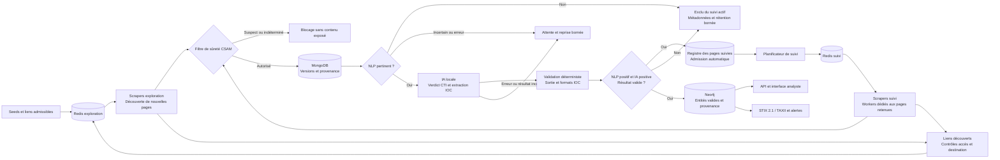

# BlueWhiteThreat
Ce projet est un crawler écrit en Go, conçu pour collecter, analyser et visualiser des informations sur les menaces provenant de sources du darkweb, avec une interface web dédiée permettant une visualisation simple et intuitive des données extraites.

Le système repose sur une architecture modulaire intégrant plusieurs mécanismes complémentaires :

**Crawler** : explore automatiquement les sources ciblées pour identifier des pages ou ressources pertinentes.

**Collectseeds** (facultatif) : soumet au crawler des points de départ issus de catalogues publics, distinctement des liens découverts pendant le crawl.

**Scraper** : traite en continu la file de rendu Chromium et sauvegarde les pages extraites dans MongoDB.

**Parser** : transforme le contenu extrait en entités exploitables (IOCs, noms de malware, groupes, infrastructures, etc.).

**Redis** : gère la file d’attente des URLs à explorer, permettant un traitement asynchrone et scalable.

**MongoDB** : stocke les données extraites sous forme de documents structurés et flexibles.

**Neo4j** : modélise les relations entre les entités pour une analyse orientée graphe.

**Frontend web** : permet la consultation des menaces collectées, l’exploration des graphes d’interconnexion et l’analyse des entités.

Ce projet vise à fournir un outil de veille automatisée sur les menaces issues du darkweb, et à faciliter leur analyse contextuelle à travers une visualisation graphique et interactive.

## Reprendre le développement

- [`docs/developpement.md`](docs/developpement.md) : plan du dépôt et vérifications locales, sans lancer de collecte ni d'entraînement.
- [Test synthétique de bout en bout](docs/validation/2026-11-24-pipeline-smoke.md) : `python3 tests/pipeline/smoke.py` ; bases jetables, pas de collecte ni d’entraînement.
- [Qualification du classifieur et du parser](docs/qualification-nlp-parser.md) : nouveau lot humain, suivi des campagnes et mesure distincte des entités.
- [Revue CTI du classifieur](docs/validation/2026-11-24-review-cti.md) : rapprocher localement les CVE du catalogue CISA KEV et retrouver les avis CERT-FR, sans modifier les verdicts.
- [`apps/classifier/EXPERIMENTS.md`](apps/classifier/EXPERIMENTS.md) : essais du classifier, conclusions, résultats négatifs et réserves à ne pas réutiliser.

## Documentation opérationnelle

- [`docs/mvp-2027-cadrage.md`](docs/mvp-2027-cadrage.md) : périmètre et contrats du MVP de janvier 2027.
- [`docs/runbook-services.md`](docs/runbook-services.md) : datasheet pour préparer, lancer, tester, diagnostiquer et modifier chaque service selon les rôles technicien, analyste et développeur.
- [Files Redis et fonctionnement continu](docs/redis-crawler-scraper.md) : états des tâches, reprise après interruption, capacité et exploitation sur Mac.
- [Isolement du scraper et sauvegardes Redis](docs/scraper-isolation-backup.md) : sandbox, réseau, sauvegarde et contrôle de restauration.
- [`monitoring/README.md`](monitoring/README.md) : démarrage et exploitation du dashboard Grafana, des métriques Prometheus et des logs Loki.

## Cartographie du code avec Graphify

[Graphify](https://github.com/Graphify-Labs/graphify) est un outil de développement
facultatif, distinct du graphe CTI dans Neo4j. Depuis la racine du dépôt :

```sh
pipx install graphifyy          # une fois si la commande graphify n'est pas installée
graphify update .               # dépôt entier
graphify update apps/classifier  # ou un seul service
```

L'analyse structurelle est locale et ne nécessite ni modèle d'IA ni clé d'API.
Le dossier `graphify-out/` est généré dans le périmètre analysé et ignoré par Git.
Consulter `GRAPH_REPORT.md`, ouvrir `graph.html` s'il a été généré, ou lancer :

```sh
graphify query "classifyArticleSource" --graph apps/classifier/graphify-out/graph.json
```

Les exclusions de `.graphifyignore` écartent notamment les corpus, les sorties
de collecte et les modèles du classifier. Aucun hook Git n'est requis.

## Accès authentifié des scrapers

Le scraper peut conserver un compte par site, réutiliser ses cookies puis se reconnecter avec les identifiants enregistrés. Les identifiants sont chiffrés en AES-256-GCM ; les cookies restent sensibles et protégés par les permissions du fichier. Une inscription optionnelle est limitée à une tentative persistante. Un adaptateur HTTP de résolution de challenge est disponible, sans fournisseur intégré ni prise en charge générique de reCAPTCHA/Turnstile.

- Configuration et exploitation : [`docs/scraper-access.md`](docs/scraper-access.md).
- Exemple de connecteur : [`apps/scraper/examples/sites.json`](apps/scraper/examples/sites.json).
- Clé locale : `apps/scraper/.credentials.env`, ignorée par Git ; ne jamais la publier ni la régénérer au redémarrage.
- Aucun site réel n'est préconfiguré. Un compte enregistré ne vaut pas admission au suivi CTI.

Cette extension est distincte du périmètre MVP historique : voir la note du cadrage.

## Pipeline cible du MVP

Les scrapers d'exploration découvrent des pages. Après contrôle de sûreté, le NLP puis l'IA décident automatiquement des pages à conserver et à suivre, avec extraction et validation des IOC. Des scrapers de suivi distincts reviennent sur ces pages à cadence configurable ; aucune validation humaine initiale ou périodique n'est requise. Chaque contenu modifié repasse par le même pipeline. Les restrictions d'accès restent applicables indépendamment de la pertinence CTI.

Ce schéma décrit la cible ; le [cadrage MVP](docs/mvp-2027-cadrage.md) et l'[architecture](docs/sidequest-architecture.md) précisent les contrats et l'état d'implémentation.


