# Cadrage de référence — MVP BlueWhiteThreat, janvier 2027

> Statut : brouillon de travail à valider par les deux étudiants  
> Dernière mise à jour : 12 octobre 2026  
> Ticket de référence : GitHub #22

## 1. Finalité du MVP

BlueWhiteThreat doit démontrer une chaîne DARKINT/CTI complète et reproductible qui collecte des contenus autorisés provenant de services Tor, de forums web et de canaux Telegram publics, les trie, en extrait des entités CTI, les corrèle dans un graphe et restitue les résultats à un analyste.

La démonstration de janvier 2027 couvre la chaîne complète. Elle doit aussi fonctionner sur un corpus sûr et figé afin de ne pas dépendre de la disponibilité de Tor, Telegram, d'un forum tiers ou d'un fournisseur de modèle le jour de la soutenance.

## 2. Parcours de bout en bout retenu

```mermaid
flowchart LR
    S[Sources approuvées\nTor, forums, Telegram] --> C[Connecteurs de collecte]
    D[Découverte automatique] --> R[Registre des sources\nCandidate]
    R --> P[Aperçu minimal sûr]
    P --> H{Validation analyste}
    H -->|Approuvée| S
    H -->|Rejetée| X[Source bloquée et décision tracée]
    C --> Q[Redis / orchestration]
    Q --> M[(MongoDB\ncontenu brut + provenance)]
    M --> N[Classifieur de pertinence]
    N -->|Non pertinent| A[Archivé / exclu du parser]
    N -->|Pertinent| L[Parser LLM local]
    L --> V[Validation déterministe]
    V --> G[(Neo4j\nentités, relations, confiance)]
    G --> API[API analyste]
    API --> UI[Interface, graphe, alertes, métriques]
    G --> STIX[Export STIX 2.1 / TAXII]

    subgraph OBS[Logs et monitoring Docker]
        DOCKER[Docker Engine\nstdout / stderr] --> ALLOY[Grafana Alloy] --> LOKI[(Loki)] --> GF[Grafana]
        DOCKER --> CAD[cAdvisor] --> PROM[(Prometheus)] --> GF
    end

    C -. logs et état .-> DOCKER
    N -. logs et état .-> DOCKER
    L -. logs et état .-> DOCKER
    API -. logs et état .-> DOCKER
    GF --> UI
```

## 3. Décisions déjà validées

| Date | Décision | Justification | Impact |
|---|---|---|---|
| 12 oct. 2026 | Le MVP couvre toute la chaîne | Démontrer la valeur analytique complète, pas seulement la collecte | Tous les composants jusqu'à l'interface font partie du scénario de démonstration |
| 12 oct. 2026 | Trois familles de sources : Tor, forums et Telegram | Représenter plusieurs écosystèmes réellement utiles en CTI | Trois connecteurs avec un contrat de données commun sont nécessaires |
| 12 oct. 2026 | La collecte combine seeds connues, ajout manuel et découverte automatique | Conserver un point de départ maîtrisé tout en enrichissant la couverture | Un registre de sources et une origine de découverte doivent être stockés |
| 12 oct. 2026 | Toute source découverte passe par une validation humaine | Éviter qu'une découverte non fiable ou dangereuse entre automatiquement dans la collecte régulière | Workflow candidate, approuvée, rejetée ou révoquée avec auteur et date |
| 12 oct. 2026 | Un aperçu minimal est permis avant validation | Donner assez de contexte à l'analyste pour décider | Seules métadonnées et court extrait sont collectés avant approbation |
| 12 oct. 2026 | Un corpus sûr et figé double les sources réelles | Garantir une démonstration reproductible et conforme | Les tests et la soutenance ne dépendent pas du réseau réel |
| 12 oct. 2026 | Ollama est le chemin d'extraction par défaut ; le cloud est un repli contrôlé | Limiter coût et exposition de contenu | Le pipeline doit fonctionner sans fournisseur distant |

## 4. Périmètre fonctionnel

### Must — indispensable au MVP

- collecte Tor continue et bornée depuis des seeds approuvées ;
- collecte de forums web validés, sans contournement de protection ;
- collecte incrémentale de canaux Telegram publics validés ;
- registre des sources, découverte automatique, aperçu minimal et validation analyste ;
- persistance normalisée dans MongoDB avec provenance ;
- triage de pertinence et boucle de revue/réentraînement sûre ;
- tableau de métriques : collecte, pertinence, erreurs et dérive du modèle ;
- extraction locale d'IOC, CVE, malware, acteurs, infrastructures, pseudonymes, wallets et TTP MITRE ATT&CK ;
- validation déterministe des formats vérifiables ;
- score de confiance explicable par entité et relation ;
- graphe Neo4j alimenté de façon idempotente ;
- parcours analyste minimal : recherche, détail, provenance, graphe et alertes ;
- export STIX 2.1/TAXII vers un consommateur de test ;
- alerting sur acteur ou TTP surveillé ;
- deux rapports d'investigation reproductibles ;
- scénario de démonstration sûr, figé et utilisable hors ligne.

### Should — important, mais différable

- historique temporel et reconstruction du graphe à une date donnée ;
- consultation des rapports dans l'interface ;
- réglage fin du score de confiance ;
- documentation de reprise complète pour une autre équipe.

### Could — seulement si le chemin critique est terminé

- connecteur Element/Matrix ;
- extraction multilingue renforcée ;
- génération automatique de rapports PDF.

### Won't — explicitement hors périmètre

- interception ou déchiffrement de communications chiffrées de bout en bout ;
- brute-force, contournement de captcha, de rate-limit ou inscription automatique ;
- cartographie ou ciblage de contenus pédopornographiques ou assimilés ;
- signalement automatique aux autorités ;
- déploiement en production chez un tiers ;
- collecte régulière d'une source découverte avant validation analyste.

## 5. Contrats entre composants

| Producteur | Sortie minimale | Consommateur | Responsabilité |
|---|---|---|---|
| Découverte / ajout manuel | identifiant de source, type, adresse, origine, date | Registre des sources | créer une candidate sans l'approuver implicitement |
| Registre des sources | statut de confiance et décision tracée | Connecteurs | autoriser uniquement les sources approuvées pour la collecte régulière |
| Connecteurs Tor/forum/Telegram | contenu, identifiant source, URL/message, auteur public si disponible, dates, provenance | MongoDB | normaliser sans perdre la donnée source utile |
| Scraper / collecteurs | document brut non classé | Classifieur | éviter les doublons et rendre les échecs rejouables |
| Classifieur | score, verdict, version du modèle, seuil, date | Parser | rendre seuls les documents pertinents éligibles à l'extraction |
| Parser | entités structurées, version du modèle, statut d'extraction | Validateur | distinguer résultat vide, succès et échec |
| Validateur | entités normalisées, rejets et motifs | MongoDB / Neo4j | éliminer les formats invalides et conserver la provenance |
| Moteur de confiance | score, facteurs et version de formule | Neo4j / API | produire un score explicable et recalculable |
| Neo4j | sous-graphe borné, relations, dates et provenance | API / STIX / alerting | assurer idempotence et corrélation |
| API | listes, détails, voisinage, métriques et alertes | Frontend | valider les entrées et borner les requêtes coûteuses |

## 6. Critères d'acceptation globaux

Le MVP est accepté si :

1. une source sûre de chacune des trois familles peut alimenter le même pipeline ;
2. une source découverte reste candidate tant qu'un analyste ne l'a pas approuvée ;
3. chaque résultat analytique conserve sa provenance et les versions de traitement ;
4. le classifieur et le parser sont évalués sur des jeux séparés et documentés ;
5. une réexécution ne crée pas de doublons fonctionnels ;
6. les erreurs d'un document ou d'un stockage secondaire ne bloquent pas tout le flux ;
7. l'interface permet de remonter d'une entité jusqu'à sa source ;
8. un sous-graphe peut être exporté en STIX 2.1 et accepté par un consommateur de test ;
9. une nouvelle mention surveillée produit une alerte idempotente ;
10. deux investigations complètes sont reproductibles depuis le corpus de démonstration ;
11. la démonstration principale reste exécutable hors ligne ;
12. aucun secret, contenu interdit ou donnée personnelle non nécessaire n'est présent dans les artefacts.

## 7. Source de vérité et documents associés

Ce document consolide les choix produit. Les détails de conception et d'implémentation restent dans :

- `docs/sidequest-architecture.md` ;
- `docs/sidequest-moscow.md` ;
- `docs/theorie-extraction-entites-cti.md` ;
- `docs/plans/2026-10-01-darkweb-scraper-design.md` ;
- `docs/plans/2026-10-01-relevance-classifier-design.md` ;
- `docs/plans/2026-09-14-entity-parser-design.md` ;
- les plans d'implémentation correspondants.

En cas de contradiction de périmètre, ce cadrage et les décisions les plus récentes du ticket #22 priment pour le MVP de janvier 2027. Le code et les tests restent la source de vérité sur l'état effectivement implémenté.

## 8. Points à valider avec l'équipe

- [ ] Valider la liste Must/Should/Could/Won't.
- [ ] Valider le schéma commun exact des documents provenant de Tor, forums et Telegram.
- [ ] Valider les critères qui font qu'une source candidate devient fiable.
- [ ] Choisir le canal externe optionnel des alertes : webhook, e-mail ou aucun pour le MVP.
- [ ] Choisir le consommateur TAXII/MISP utilisé pour la démonstration.
- [ ] Relire et approuver ce document à deux dans le ticket #22.
