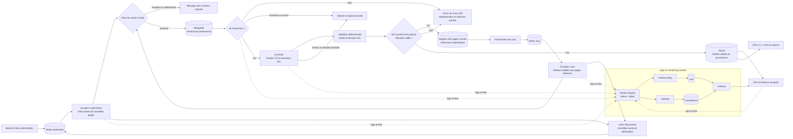

# Cadrage de référence — MVP BlueWhiteThreat, janvier 2027

> Statut : brouillon de travail à valider par les deux étudiants  
> Dernière mise à jour : 19 octobre 2026
> Ticket de référence : GitHub #22

## 1. Finalité du MVP

BlueWhiteThreat doit démontrer une chaîne DARKINT/CTI complète et reproductible qui collecte des contenus autorisés provenant de services Tor, de forums web et de canaux Telegram publics, les trie, en extrait des entités CTI, les corrèle dans un graphe et restitue les résultats à un analyste.

La démonstration de janvier 2027 couvre la chaîne complète. Elle doit aussi fonctionner sur un corpus sûr et figé afin de ne pas dépendre de la disponibilité de Tor, Telegram, d'un forum tiers ou d'un fournisseur de modèle le jour de la soutenance.

## 2. Parcours de bout en bout retenu

## 3. Décisions de cadrage

| Date | Décision | Justification | Impact |
|---|---|---|---|
| 12 oct. 2026 | Le MVP couvre toute la chaîne | Démontrer la valeur analytique complète, pas seulement la collecte | Tous les composants jusqu'à l'interface font partie du scénario de démonstration |
| 12 oct. 2026 | Trois familles de sources : Tor, forums et Telegram | Représenter plusieurs écosystèmes réellement utiles en CTI | Trois connecteurs avec un contrat de données commun sont nécessaires |
| 12 oct. 2026 | La collecte combine seeds connues, ajout manuel et découverte automatique | Conserver un point de départ maîtrisé tout en enrichissant la couverture | Un registre de sources et une origine de découverte doivent être stockés |
| 19 oct. 2026 | Admission automatique par page : NLP positif puis verdict CTI positif de l'IA, avec résultat validé | Retenir automatiquement les pages utiles sans approbation humaine initiale ou périodique | Remplace la décision du 12 octobre imposant une validation analyste ; la pertinence ne vaut pas autorisation d'accès |
| 19 oct. 2026 | Deux populations distinctes de scrapers : exploration et suivi | Découvrir de nouvelles pages tout en actualisant les pages retenues | Workers, files Redis et budgets séparés ; même pipeline de sûreté et d'analyse |
| 12 oct. 2026 | Un corpus sûr et figé double les sources réelles | Garantir une démonstration reproductible et conforme | Les tests et la soutenance ne dépendent pas du réseau réel |
| 12 oct. 2026 | Ollama est le chemin d'extraction par défaut ; le cloud est un repli contrôlé | Limiter coût et exposition de contenu | Le pipeline doit fonctionner sans fournisseur distant |

## 4. Périmètre fonctionnel

### Must — indispensable au MVP

- collecte Tor continue et bornée depuis des seeds admissibles selon la politique d’accès ;
- collecte incrémentale de pages de forums retenues automatiquement par NLP et IA, publics ou accessibles avec un compte autorisé, avec reprise de session sécurisée et sans contournement de protection ;
- filtre de sûreté CSAM avant persistance durable, indexation, analyse et affichage ;
- gestion explicite des accès bloqués, sessions expirées et collectes partielles ;
- collecte incrémentale de canaux Telegram publics admissibles ;
- registre des sources et des pages, découverte automatique, admission NLP/IA et revisite par des scrapers de suivi distincts des scrapers d’exploration ;
- persistance normalisée dans MongoDB avec provenance ;
- triage de pertinence et boucle de revue/réentraînement sûre ;
- tableau de métriques : collecte, pertinence, erreurs et dérive du modèle ;
- extraction locale d'IOC, CVE, malware, acteurs, infrastructures, pseudonymes, wallets et TTP MITRE ATT&CK ;
- validation déterministe des formats vérifiables ;
- score de confiance explicable par entité et relation ;
- graphe Neo4j alimenté de façon idempotente ;
- parcours analyste minimal : recherche, détail, provenance, graphe et alertes ;
- export STIX 2.1/TAXII vers un consommateur de test ;
- alerting sur acteur ou TTP surveillé ;
- deux rapports d'investigation reproductibles ;
- scénario de démonstration sûr, figé et utilisable hors ligne.

### Should — important, mais différable

- historique temporel et reconstruction du graphe à une date donnée ;
- consultation des rapports dans l'interface ;
- réglage fin du score de confiance ;
- documentation de reprise complète pour une autre équipe.

### Could — seulement si le chemin critique est terminé

- connecteur Element/Matrix ;
- extraction multilingue renforcée ;
- génération automatique de rapports PDF.

### Won't — explicitement hors périmètre

- interception ou déchiffrement de communications chiffrées de bout en bout ;
- brute-force, contournement de captcha, de rate-limit ou inscription automatique ;
- cartographie ou ciblage de contenus pédopornographiques ou assimilés ;
- signalement automatique aux autorités ;
- déploiement en production chez un tiers ;
- validation humaine obligatoire pour admettre une page pertinente ou renouveler son suivi ;
- collecte hors des droits d'accès ou contournant une protection, même si NLP et IA jugent le contenu pertinent.

### Admission automatique et deux populations de scrapers

Le parcours nominal ne nécessite aucune validation humaine, ni au départ ni à chaque passage. Les scrapers d'exploration parcourent les seeds et liens admissibles selon la politique d'accès, récupèrent les pages et découvrent de nouveaux liens. Après le filtre de sûreté, le NLP évalue chaque page. S'il la juge pertinente, l'IA locale produit un verdict CTI explicite et extrait les IOC et autres entités ; la validation déterministe contrôle la structure de sortie et les formats vérifiables.

Une page est automatiquement retenue lorsque le score NLP dépasse son seuil configuré, que le verdict CTI de l'IA est positif et que le résultat structuré est valide. L'absence d'IOC n'est pas à elle seule un rejet : une page peut contenir un acteur ou une TTP utile. Un résultat vide, ambigu ou en échec n'est pas une admission positive ; les échecs techniques sont rejoués avec un nombre de tentatives borné. Les scores, seuils, verdicts, versions de modèles et motifs de décision sont conservés. Cette admission porte sur la page, pas sur l'ensemble du forum ni sur ses droits d'accès.

Les pages retenues entrent dans le registre de suivi. Une autre population de scrapers, dédiée au suivi, revient automatiquement sur ces pages pour détecter les nouveaux messages et éditions. Ces workers ne parcourent pas librement le darkweb : ils consomment uniquement les cibles enregistrées et leur pagination autorisée. Tout nouveau lien découvert par le suivi est renvoyé à la file d'exploration après les contrôles d'accès et de destination ; il passe ensuite par sa propre admission NLP/IA.

Les deux populations peuvent partager le code des connecteurs, mais utilisent des processus ou conteneurs distincts, les files Redis `crawl:exploration` et `crawl:refresh`, des pools de workers et des budgets séparés. Une saturation de l'exploration ne doit pas empêcher l'actualisation. Les limites de débit et les sessions restent coordonnées par source entre les deux pools pour ne pas multiplier la charge autorisée. Des verrous à durée limitée par page évitent les requêtes concurrentes et doublons entre pools.

### Planification et actualisation des pages retenues

Le registre distingue une source (adresse, mode d'accès, limites et état technique) d'une page suivie (`source_id`, URL canonique ou identifiant de fil/message). Une page conserve `tracking_status` (`active`, `paused`, `inactive`), `crawl_interval_seconds`, `last_attempt_at`, `last_success_at`, `next_crawl_at`, son curseur, empreinte, `ETag`, `Last-Modified` et la référence de la dernière décision NLP/IA. Le suivi régulier exige un état actif et un accès admissible. Les pages `paused` pour un incident transitoire disposent d’une échéance de reprise distincte et d’un compteur de tentatives ; seules ces reprises bornées sont programmées automatiquement. Les suspensions pour refus d’accès ou sûreté excluent ces reprises tant que le blocage subsiste.

La cadence initiale proposée est d'une heure, configurable selon l'activité et les limites d'accès. Le planificateur programme les pages arrivées à échéance dans `crawl:refresh`. Les checkpoints et échéances persistent ; un redémarrage reprend le travail sans créer une tâche pour chaque passage manqué. Un retard ne nécessite aucune approbation humaine.

Une réponse 304 ou une empreinte inchangée met à jour la date de vérification sans relancer l'analyse. Toute nouvelle version repasse par le filtre de sûreté avant stockage durable, puis par NLP, IA et validation avant actualisation des résultats. Les versions, écritures graphe et alertes sont idempotentes. Une réponse ponctuellement vide ou indisponible ne prouve pas une suppression. Un nouveau verdict NLP ou IA négatif retire automatiquement la page du suivi actif (`inactive`) en conservant l'historique autorisé ; une redécouverte ultérieure par l'exploration peut la réadmettre. Un échec technique ou résultat incertain place la page en attente (`paused`) avec reprise bornée, sans effacer l'analyse antérieure ni la présenter comme actuelle.

Chaque passage a un budget de pages, d'octets et de temps. La pagination des fils conserve un curseur et un balayage tournant des pages anciennes détecte les éditions tardives. La couverture partielle est visible ; les passages suivants poursuivent le travail en réservant une part du budget aux nouveautés. La cadence ralentit ou accélère automatiquement dans les bornes configurées. Les erreurs transitoires utilisent une temporisation ; les alertes de sûreté et refus d'accès suspendent la collecte, indépendamment des verdicts CTI.

L'interface affiche les décisions automatiques, le dernier passage, la dernière réussite, le prochain passage, les volumes nouveaux/modifiés/inchangés et la couverture. Les métriques distinguent exploration et suivi : profondeur et nouvelles pages d'un côté, fraîcheur et retard de l'autre. L'analyste peut corriger ou suspendre une cible, mais son intervention n'est pas une condition du parcours nominal.

### Collecte des forums : accès, comptes et sessions

L'admission NLP/IA d'une page ne donne aucun droit d'accès supplémentaire. Chaque source admissible précise les domaines, chemins et rubriques autorisés, le mode d'accès (public, API ou compte), les limites de débit, la justification de l'autorisation et son responsable. Les messages privés et espaces non autorisés restent exclus. Une redirection ou un lien vers un autre domaine repasse par les contrôles de destination et la file d’exploration, puis par sa propre admission automatique.

Pour un forum demandant un identifiant et un mot de passe, l'analyste fournit un compte dédié autorisé ou réalise l'inscription par le parcours officiel. Le MVP n'automatise pas la création de comptes. Le connecteur peut ensuite se connecter normalement et réutiliser sa session dans le périmètre approuvé. Une validation e-mail, une invitation, une MFA ou un CAPTCHA suspend le connecteur jusqu'à intervention humaine via le parcours officiel. Si l'accès automatisé reste interdit ou bloqué, utiliser une API, un export fourni par l'opérateur ou laisser la source en attente.

MongoDB conserve uniquement une référence opaque vers un coffre de secrets, jamais le mot de passe en clair. Les mots de passe, cookies et jetons réutilisables sont chiffrés au repos dans un stockage de secrets avec accès limité au connecteur concerné ; la clé reste hors de MongoDB et du dépôt. Ils sont exclus des logs, traces, captures, corpus, exports et entrées de modèles. Prévoir révocation, rotation, expiration et suppression des sessions ; ne jamais utiliser des identifiants trouvés dans les contenus collectés.

Le connecteur expose un état distinct du statut de suivi de la page : `ready`, `auth_required`, `human_action_required`, `rate_limited`, `temporarily_unavailable`, `blocked` ou `revoked`. Il conserve le motif, la dernière réussite, la prochaine tentative autorisée et un curseur de reprise. Un refus persistant stoppe les nouvelles tentatives ; aucun changement de compte, proxy ou identité ne sert à contourner le refus.

### Filtre de sûreté avant exploitation

Le contrôle commence à la découverte : liste de blocage, métadonnées et aperçu textuel minimal, sans chargement automatique des médias ni pièces jointes. Les sources déjà identifiées comme interdites sont rejetées avant collecte. Pour toute page admissible, y compris lors de la première exploration, les réponses passent dans une zone de traitement éphémère et isolée avant toute écriture dans MongoDB, file contenant le contenu brut, graphe, index, corpus ou stockage d'observabilité. Le MVP privilégie la collecte textuelle et désactive les téléchargements de médias.

Un filtre ne peut pas garantir qu'aucun contenu interdit ne sera reçu : il faut recevoir une réponse pour l'évaluer. Tout résultat suspect, indéterminé ou toute indisponibilité du filtre ferme le passage vers le pipeline. Le contenu est écarté du flux ; la revue porte sur des métadonnées non sensibles, sans aperçu du contenu suspect. Les buffers sont purgés, sans copie durable du contenu rejeté. Seuls identifiant de source, horodatage, version du contrôle et motif technique non sensible sont journalisés. Une source suspecte est suspendue jusqu'à décision tracée ; la pertinence CTI ne permet jamais de passer outre ce contrôle.

### Obstacles de collecte et réponses prévues

Cette matrice couvre les principaux incidents attendus ; un incident inconnu suspend la source avec un motif explicite plutôt que de déclencher une stratégie de contournement.

| Obstacle | Réponse attendue du MVP | Limite ou signal analyste |
|---|---|---|
| Formulaire de connexion | Connexion normale avec compte dédié autorisé et secret référencé | `auth_required` si aucun compte utilisable |
| Inscription, invitation, validation e-mail, MFA | Parcours officiel effectué par une personne autorisée, puis reprise | `human_action_required`, aucune boucle de création de comptes |
| CAPTCHA ou challenge anti-bot | Suspendre ; intervention humaine officielle ou accès API/export approuvé | Aucun solveur automatisé ni service de contournement |
| Session expirée ou jeton CSRF renouvelé | Rafraîchir par le flux normal ; une reconnexion bornée puis arrêt en cas d'échec | Ne pas confondre page de connexion et contenu collecté |
| Compte bloqué, droits retirés, HTTP 401/403 | Arrêt, invalidation de session et revue de l'autorisation | Aucun compte de remplacement automatique |
| HTTP 429, quota ou surcharge | Respecter `Retry-After`, débit par source, temporisation exponentielle avec jitter et plafond | Pas de rotation d'identité pour dépasser un quota |
| Restriction explicite de collecte | Suspendre et demander un accès approprié à l'opérateur | Verdict NLP/IA insuffisant pour lever une restriction |
| DNS, TLS, Tor ou serveur indisponible | Délais maximaux, tentatives bornées, circuit breaker et reprise différée | Ne pas désactiver la vérification TLS |
| Pages rendues en JavaScript | API officielle en priorité ; navigateur isolé si autorisé, avec mêmes limites | Aucun téléchargement ou script hors périmètre requis pour la collecte |
| Pagination, fils longs ou contenu chargé progressivement | Curseur persistant, checkpoints par page, plafond de profondeur et de volume | Couverture partielle affichée, aucune complétude supposée |
| Doublons, éditions et suppressions | Identifiant stable source/message, empreinte, dates de collecte et versions utiles | Ne pas conclure à une suppression après un seul échec réseau |
| Structure HTML modifiée, encodage ou langue inattendue | Validation du résultat, normalisation et alerte sur baisse du taux d'extraction | Page vide ou erreur de parsing distincte d'une absence de résultat |
| Redirections, URL piégées, SSRF | Vérifier chaque destination et résolution réseau ; interdire réseaux internes, métadonnées cloud et schémas non autorisés | Le transport Tor approuvé reste distinct des destinations web interdites |
| Pièces jointes, archives, fichiers exécutables | Téléchargement désactivé pour le MVP ; métadonnées sûres seulement | Aucun fichier exécuté ou archive décompressée automatiquement |
| Réponse trop grosse, boucle de liens, stockage ou file saturée | Limites d'octets et de temps, déduplication d'URL, backpressure et arrêt contrôlé | Signaler la troncature et reprendre depuis le dernier checkpoint validé |
| Contenu hostile ou injection de prompt | Traiter le texte comme donnée non fiable ; aucun outil ou accès secret déclenché par son contenu | Isoler l'analyse et valider les sorties structurées |
| Suspicion CSAM ou filtre indisponible | Bloquer avant stockage durable et analyse, purger les buffers, suspendre la source | Aucun contenu suspect dans l'interface ou les logs |

## 5. Contrats entre composants

| Producteur | Sortie minimale | Consommateur | Responsabilité |
|---|---|---|---|
| Découverte / ajout manuel | source, URL, origine et date | Redis exploration | programmer une exploration si la destination et l'accès sont admissibles, sans validation humaine requise |
| Scrapers exploration | page récupérée et liens découverts | Filtre de sûreté / exploration | découvrir de nouvelles pages avec budgets bornés ; aucune admission implicite au suivi |
| NLP + IA + validateur | scores, verdict CTI, entités, versions et motifs | Registre des pages suivies | admettre automatiquement une page si les deux verdicts sont positifs et le résultat valide |
| Registre sources / pages | état d'accès, état de suivi, URL, échéance et checkpoint | Planificateur / connecteurs | séparer droits d'accès, pertinence et état technique ; appliquer les suspensions |
| Planificateur de suivi | page active, prochaine échéance, cadence et checkpoint | Redis suivi | programmer les revisites sans approbation humaine, éviter les tâches concurrentes |
| Scrapers suivi | nouvelle version ou constat inchangé, provenance | Filtre de sûreté / pipeline commun | revisiter uniquement les pages suivies et leur pagination ; renvoyer les nouveaux liens à l'exploration |
| Filtre de sûreté | verdict, version, date et motif non sensible | Persistance / orchestration | autoriser seulement les contenus ayant passé le contrôle ; bloquer si indéterminé |
| Scraper / collecteurs | document brut autorisé non classé | Classifieur | éviter les doublons et rendre les échecs rejouables |
| Classifieur | score, verdict, version du modèle, seuil, date | Parser | rendre seuls les documents pertinents éligibles à l'extraction |
| Parser | entités structurées, version du modèle, statut d'extraction | Validateur | distinguer résultat vide, succès et échec |
| Validateur | entités normalisées, rejets et motifs | MongoDB / Neo4j | éliminer les formats invalides et conserver la provenance |
| Moteur de confiance | score, facteurs et version de formule | Neo4j / API | produire un score explicable et recalculable |
| Neo4j | sous-graphe borné, relations, dates et provenance | API / STIX / alerting | assurer idempotence et corrélation |
| API | listes, détails, voisinage, métriques et alertes | Frontend | valider les entrées et borner les requêtes coûteuses |

## 6. Critères d'acceptation globaux

Le MVP est accepté si :

1. une source sûre de chacune des trois familles peut alimenter le même pipeline ;
2. une page découverte et admissible passe automatiquement par sûreté, NLP, IA et validation ; seuls deux verdicts positifs et un résultat valide l'inscrivent au suivi, sans action humaine ;
3. chaque résultat analytique conserve sa provenance et les versions de traitement ;
4. le classifieur et le parser sont évalués sur des jeux séparés et documentés ;
5. une réexécution ne crée pas de doublons fonctionnels ;
6. les erreurs d'un document ou d'un stockage secondaire ne bloquent pas tout le flux ;
7. l'interface permet de remonter d'une entité jusqu'à sa source ;
8. un sous-graphe peut être exporté en STIX 2.1 et accepté par un consommateur de test ;
9. une nouvelle mention surveillée produit une alerte idempotente ;
10. deux investigations complètes sont reproductibles depuis le corpus de démonstration ;
11. la démonstration principale reste exécutable hors ligne ;
12. aucun secret, contenu interdit ou donnée personnelle non nécessaire n'est présent dans les artefacts ;
13. sur un forum de test contrôlé, un compte autorisé permet connexion, reprise après redémarrage et collecte sans doublons ; MongoDB ne contient qu'une référence de secret ;
14. les scénarios session expirée, MFA/CAPTCHA, 403 et 429 produisent les états attendus, sans tentative de contournement ni boucle de connexion ;
15. des fixtures synthétiques inoffensives vérifient qu'un verdict de sûreté suspect, indéterminé ou un filtre indisponible empêche toute persistance durable, analyse et exposition du contenu ; aucun contenu CSAM réel n'est utilisé en test ;
16. pagination interrompue, changement HTML et réponse surdimensionnée sont détectés, avec couverture partielle explicite et reprise bornée ;
17. les redirections hors périmètre et vers des réseaux internes sont bloquées, et aucun secret n'apparaît dans les logs ou exports ;
18. une horloge simulée vérifie qu'une page admise automatiquement est revisitée par les workers de suivi à sa cadence sans intervention humaine ; un retard n'annule pas son admission ;
19. sur des fixtures inoffensives, les passages successifs détectent nouveau message et édition, évitent les doublons sur contenu inchangé ou réponse 304 et reprennent après interruption sans collecte concurrente ;
20. une révocation ou une alerte de sûreté bloque les requêtes suivantes, y compris celles de tâches déjà en file ; une destination nouvelle admissible repasse par exploration et admission automatique, sans hériter du suivi de la page initiale ;
21. un budget de collecte limité conserve un checkpoint et permet de progresser sur les pages anciennes tout en collectant les nouveautés aux passages suivants ;
22. les files et workers d'exploration et de suivi sont distincts : saturer l'exploration n'empêche pas le suivi, et les deux pools respectent ensemble le débit maximal par source ;
23. une version modifiée repasse par toute la chaîne ; un verdict négatif désactive son suivi, un échec technique le met en attente avec reprise bornée, et une redécouverte positive peut réactiver la page.

## 7. Source de vérité et documents associés

Ce document consolide les choix produit. Les détails de conception et d'implémentation restent dans :

- `docs/sidequest-architecture.md` ;
- `docs/sidequest-moscow.md` ;
- `docs/theorie-extraction-entites-cti.md` ;
- `docs/plans/2026-10-01-darkweb-scraper-design.md` ;
- `docs/plans/2026-10-01-relevance-classifier-design.md` ;
- `docs/plans/2026-09-14-entity-parser-design.md` ;
- les plans d'implémentation correspondants.

En cas de contradiction de périmètre, ce cadrage et les décisions les plus récentes du ticket #22 priment pour le MVP de janvier 2027. Le code et les tests restent la source de vérité sur l'état effectivement implémenté.

## 8. Points à valider avec l'équipe

- [ ] Valider la liste Must/Should/Could/Won't.
- [ ] Valider le schéma commun exact des documents provenant de Tor, forums et Telegram.
- [ ] Fixer les seuils NLP, le contrat du verdict CTI de l'IA et les bornes de reprise des pages en attente.
- [ ] Valider la cadence initiale de revisite automatique (une heure), ses bornes par source et les budgets de collecte.
- [ ] Choisir le canal externe optionnel des alertes : webhook, e-mail ou aucun pour le MVP.
- [ ] Choisir le consommateur TAXII/MISP utilisé pour la démonstration.
- [ ] Relire et approuver ce document à deux dans le ticket #22.
