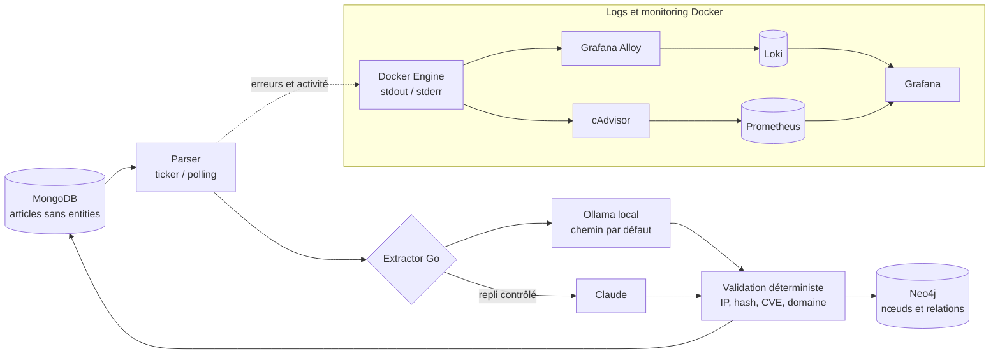

# Design — Service Parser (extraction d'entités CTI)

## Contexte

BlueWhiteThreat collecte aujourd'hui du contenu brut (crawler → scraper → MongoDB, collection `article`) sans aucune extraction d'entités : pas d'IOCs, pas de noms de malware/groupes, pas de scoring. L'API (`GET /data`) renvoie un dump Mongo non filtré, et la page `ioc.vue` du front est un placeholder vide.

Objectif de ce chantier (priorité #1 de la roadmap CTI, cf. discussion) : combler ce vide avec un service **parser** qui transforme le texte brut scrapé en entités exploitables (IOCs, CVEs, malware, groupes/acteurs, infrastructures), stockées dans MongoDB et modélisées en relations dans Neo4j. C'est le prérequis technique aux étapes suivantes (scoring/triage automatique, enrichissement externe).

## Objectif produit

Automatiser 80-90% du travail de collecte/enrichissement/triage aujourd'hui fait par un analyste CTI junior, en gardant l'humain sur la validation/attribution/relation client. L'extraction d'entités est le premier maillon : sans elle, aucun scoring ni enrichissement n'est possible.

## Décisions validées

- **Extraction par LLM**, pas par regex/dictionnaires Go : plus flexible sur du texte non structuré (articles, pages darkweb), qui varie fortement en forme.
- **Service séparé** `apps/parser/`, cohérent avec le style existant (crawler, scraper, api sont chacun des binaires Go indépendants avec leur propre boucle). Découple le rythme de scraping du rythme d'extraction LLM, permet de rejouer l'extraction sans re-scraper.
- **Modèle local par défaut (Ollama), API Claude en filet de sécurité conditionnel** : objectif de coût quasi nul tout en gardant une fiabilité correcte sur les cas difficiles.

## Architecture



### Interface Extractor

```go
type Extractor interface {
    Extract(ctx context.Context, text string) (Entities, error)
}

type Entities struct {
    IOCs struct {
        IPs     []string
        Hashes  []string
        Domains []string
        URLs    []string
    }
    CVEs          []string
    Malware       []string
    ThreatActors  []string
    Infrastructure []string
}
```

Les deux implémentations (`OllamaExtractor`, `ClaudeExtractor`) respectent la même interface et le même schéma JSON de sortie, ce qui permet de basculer ou de chaîner les deux sans changer le reste du pipeline.

### Modèle local

`qwen2.5:14b-instruct` par défaut (repli `llama3.1:8b-instruct` si contrainte de ressources). Choisi pour son bon compromis entre fiabilité de reconnaissance des noms de malware/APT (peu fréquents dans les corpus, donc plus sensibles à la taille du modèle) et charge machine raisonnable (16-32 Go RAM/VRAM). Appel via l'API Ollama `POST /api/chat` avec `format` = JSON Schema (mode structuré, supporté depuis Ollama v0.5), même schéma que `Entities`.

### Stratégie de fiabilité à coût nul

1. **Validation regex post-extraction** : formats IP/hash/CVE/domaine vérifiés après extraction LLM. Élimine les hallucinations de format, déterministe, gratuit.
2. **Escalade conditionnelle vers Claude** (Haiku 4.5, via Batches API — 50% moins cher que l'API synchrone) uniquement si :
   - l'extraction locale échoue la validation du schéma, ou
   - le résultat est vide alors qu'une regex de secours détecte un pattern IOC évident que le LLM local a raté.

   Ça borne la dépense Claude à la fraction difficile du volume (estimation : quelques %), au lieu de payer pour chaque article. Le batch d'escalade tourne à un rythme propre (ex. une fois par jour), pas par article.

### Déclenchement

Ticker + polling MongoDB (cohérent avec le style `scraper`/`crawler` existant, basé sur `time.Ticker`) : le parser interroge périodiquement les articles sans champ `entities`, plutôt qu'un déclenchement événementiel via Redis. Plus simple, découplé, et suffisant tant que le volume reste de l'ordre de quelques milliers d'articles/jour.

### Écriture des résultats

- **MongoDB** : ajout du champ `entities` (structure `Entities`) sur le document `article` existant.
- **Neo4j** : création de noeuds `Entity` typés (IOC, CVE, Malware, ThreatActor, Infrastructure) avec une relation `MENTIONED_IN` vers le noeud `URL`/article existant, permettant l'analyse de graphe (ex. quels acteurs sont liés à quelles infrastructures).

## Gestion des erreurs

- Timeout ou erreur Ollama → retry limité, puis passage direct à l'escalade Claude (le document n'est pas laissé sans tentative).
- Échec de validation Neo4j (nœud non créé) → l'entité reste dans Mongo, log d'erreur ; ne bloque pas le traitement des articles suivants.
- Aucune entité trouvée après extraction + validation → document marqué comme traité avec `entities` vide (évite de le retraiter en boucle), distinct d'un document non encore traité.

## Hors périmètre (roadmap suivante)

- Scoring/triage automatique des articles (priorité #2).
- Enrichissement externe (VirusTotal, flux CVE, MISP) (priorité #3).
- Élargissement des sources de collecte (priorité #4).
- Affichage front des IOCs (`ioc.vue`) — dépend de ce chantier mais n'est pas traité ici.
