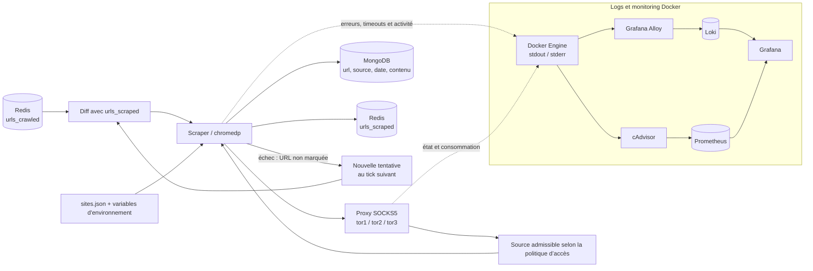

# Design — Scraper générique de contenu darkweb (`apps/scraper` v2)

> Mise à jour de périmètre — 19 octobre 2026 : ce plan décrit le raccordement initial du scraper. Pour la cible MVP, les scrapers d’exploration et de suivi sont distincts ; l’admission au suivi est automatique après sûreté, NLP et verdict CTI positif de l’IA avec résultat validé. La vérification humaine mentionnée dans ce plan est facultative et ne bloque pas la collecte. Voir [le cadrage](../mvp-2027-cadrage.md) et [l’architecture](../sidequest-architecture.md).

## Contexte

Le scraper actuel (`apps/scraper/internal/sites/DarkThreat.go`) ne récupère pas de contenu darkweb réel : il navigue en dur vers `http://localhost:8081`, un fixture de test local avec une structure HTML spécifique (`div.card`), et ne passe par aucun proxy Tor. Le crawler (`apps/crawler`), lui, parcourt bien de vraies pages `.onion` via Tor (rotation `tor1/tor2/tor3`, vérifié fonctionnel dans cet environnement), mais ne persiste que les URLs et liens (Neo4j) — jamais le contenu des pages.

Résultat : le pipeline décrit dans la vision produit (crawler découvre → scraper récupère le contenu → NLP/classifieur juge la pertinence) n'est aujourd'hui pas branché pour du vrai contenu darkweb. Ce chantier referme ce tronçon : crawler → scraper → contenu brut en Mongo, source conservée pour vérification humaine par un expert CTI.

## Décisions validées

- **Source des URLs** : le scraper consomme le set Redis `urls_crawled` déjà rempli par le crawler (même instance Redis, `SADD` sur `urls_crawled` dans `apps/crawler/internal/db/redis.go`). Pas de lien Neo4j nécessaire côté scraper.
- **Déduplication** : un set Redis dédié `urls_scraped` marque les URLs déjà traitées par le scraper. À chaque tick, le scraper calcule `urls_crawled - urls_scraped` (diff d'ensembles) pour ne traiter que les nouvelles URLs.
- **Technique de récupération** : `chromedp` (déjà une dépendance du projet, gère JS et formulaires), auquel on ajoute la configuration proxy SOCKS5 Tor manquante (rotation `tor1/tor2/tor3`, même principe que le crawler).
- **Authentification** : remplissage de formulaires de login **avec identifiants fournis explicitement** par config — pas de brute-force, pas de contournement de sécurité, pas d'inscription automatique. Si aucune config de login n'existe pour un domaine, le scraper récupère la page telle quelle (visiteur anonyme).
- **Boucle de priorisation recrawl (issue #9)** : explicitement **hors périmètre**. Ce chantier ne fait que la moitié "forward" du pipeline (crawler → scraper → contenu). La moitié "feedback" (classifieur → priorisation du recrawl) reste un chantier séparé, à faire une fois qu'il existe du contenu réel à classifier.

## Architecture



## Configuration des sites (`apps/scraper/data/sites.json`)

Fichier éditable sans recompiler, une entrée optionnelle par domaine `.onion` :

```json
{
  "exampleforum.onion": {
    "login_url": "http://exampleforum.onion/login",
    "username_selector": "#username",
    "password_selector": "#password",
    "submit_selector": "button[type=submit]",
    "username_env": "SITE_EXAMPLEFORUM_USER",
    "password_env": "SITE_EXAMPLEFORUM_PASS"
  }
}
```

- Les identifiants ne sont jamais stockés dans ce fichier, seulement les **noms** des variables d'environnement à lire (`username_env`/`password_env`).
- Un domaine absent de ce fichier → scraping simple, pas de tentative de login.

## Modèle de données (Mongo)

Nouveau type de document (pas de réutilisation du schéma `Article` existant, qui est spécifique au fixture DarkThreat) :

```go
type ScrapedPage struct {
    URL       string    `bson:"url"`
    Source    string    `bson:"source"`    // identique à URL — explicite pour la relecture humaine
    ScrapedAt time.Time `bson:"scraped_at"`
    Content   string    `bson:"content"`
}
```

- Collection : `BlueWhiteThreat.article` (même collection que l'existant — le classifieur lit déjà `article.content` sans distinction de sous-type).
- Index unique sur `url` pour l'upsert (réutilise `db.SaveAllEntries`, déjà générique par réflexion sur champs uniques).

## Gestion des erreurs

1. Page inaccessible (timeout, proxy down) → loggé, URL non ajoutée à `urls_scraped`, retentée au tick suivant.
2. Login échoué (sélecteur introuvable, identifiants refusés) → loggé, page non récupérée, même traitement qu'un échec réseau (pas de distinction fine dans un premier temps).
3. Page récupérée mais contenu vide après extraction → document quand même upserté (laisser la trace qu'elle a été tentée), `urls_scraped` mis à jour pour ne pas boucler indéfiniment sur une page structurellement vide.

## Tests

- Config `sites.json` : parsing, domaine sans entrée → pas de tentative de login.
- Diff Redis `urls_crawled \ urls_scraped` : déterminisme sur jeux d'URLs connus.
- Upsert Mongo : round-trip avec `SaveAllEntries` sur le nouveau type `ScrapedPage`.
- Proxy Tor : test d'intégration optionnel (dépend de la connectivité réseau réelle, pas exécuté en CI).

## Hors périmètre (volontairement)

- Boucle de priorisation du recrawl basée sur le verdict du classifieur (issue #9).
- Brute-force, contournement de sécurité (captcha, rate-limit), inscription automatique à des forums.
- Scraping multi-pages au sein d'un même site (pagination, exploration au-delà de l'URL fournie par le crawler) — une page = une URL = un document.
- Remplacement du schéma `Article` (DarkThreat.go) existant — il reste en place, non modifié, seulement plus utilisé comme chemin par défaut.
