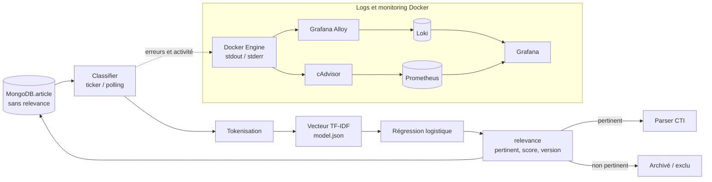

# Design — Service de classification de pertinence CTI (`apps/classifier`)

## Contexte

Le crawler et le scraper ramènent du texte brut (articles de blogs sécu, pages darkweb, forums) dans MongoDB (`BlueWhiteThreat.article`), sans distinction entre ce qui est réellement pertinent pour un analyste CTI et ce qui ne l'est pas (pages hors-sujet, bruit, contenu sans rapport avec la cybersécurité). Le chantier parser (conçu en parallèle, cf. `docs/plans/2026-09-14-entity-parser-design.md`) prévoit d'extraire des entités (IOCs, CVEs, malware, groupes) de chaque article via un LLM — un traitement coûteux en CPU/GPU qu'il est inutile de lancer sur un article non pertinent.

Objectif de ce chantier : un service dédié qui score chaque article scrapé ("pertinent CTI" vs "non pertinent") et écrit ce score dans Mongo, en amont du parser. C'est la brique "scoring/triage automatique" identifiée comme priorité #2 de la roadmap dans le doc théorie entity-parser (section 9), ici restreinte à une pertinence binaire générale (pas de catégorisation fine par type de menace, pas de ciblage par client — hors périmètre).

## Décisions validées

- **Position pipeline** : entre scraper et parser. Le classifieur lit les articles déjà en Mongo et y ajoute un champ `relevance` ; le parser (quand il sera mergé) ne traitera que les articles avec `relevance.relevant == true`.
- **Modèle dédié, pas de réutilisation du LLM d'extraction** : un modèle léger et rapide, entraîné spécifiquement pour cette tâche, plutôt que de solliciter Ollama/Claude pour un simple oui/non. Objectif : coût et latence minimaux pour une tâche de triage exécutée sur tout le flux.
- **Technique : TF-IDF + régression logistique**, implémentée nativement en Go — cohérent avec le reste du repo (crawler/scraper/api sont tous des binaires Go indépendants), pas de runtime supplémentaire à maintenir, pas de dépendance ML lourde nécessaire pour cet algorithme.
- **Données d'entraînement : bootstrap par mots-clés + relecture manuelle.** Un premier jeu d'exemples est généré automatiquement à partir des articles déjà scrapés via une liste de mots-clés CTI, puis corrigé à la main avant l'entraînement.
- **Seuil de pertinence par défaut : 0.5** (probabilité sigmoïde ≥ 0.5 ⇒ pertinent), ajustable au moment de l'entraînement selon les métriques observées, et surchargeable à l'exécution via variable d'environnement.

## Architecture



### Entraînement (offline, hors du service runtime)

Deux commandes séparées, non déployées en continu (exécutées ponctuellement par un humain) :

**`apps/classifier/cmd/bootstrap`**
- Se connecte à Mongo, lit `BlueWhiteThreat.article.content` pour les articles existants.
- Applique une liste de mots-clés CTI (`apps/classifier/data/seed_keywords.json`, éditable sans recompiler — ransomware, CVE, breach, exploit, leak, APT, C2, malware, etc.) : présence d'au moins N mots-clés ⇒ label `1` provisoire, sinon `0`.
- Écrit un CSV (`text,label`) destiné à être relu et corrigé à la main avant l'entraînement. C'est un point de passage humain volontaire — le bootstrap ne prétend pas produire une vérité terrain fiable, seulement un point de départ qui coûte moins cher à corriger qu'à écrire de zéro.

**`apps/classifier/cmd/train`**
- Lit le CSV corrigé.
- Construit le vocabulaire (tokens retenus par fréquence document, plafonné pour borner la taille du modèle) et les poids IDF associés.
- Split 80/20 train/eval.
- Entraîne une régression logistique binaire par descente de gradient (régularisation L2 pour limiter le surapprentissage sur un petit corpus).
- Affiche les métriques sur le holdout (accuracy, precision, recall, F1) — permet de juger si le seuil 0.5 par défaut doit être ajusté avant de livrer le modèle.
- Sérialise `{vocabulary, idf, weights, bias, threshold, version}` dans `model.json`.

Ce flux (bootstrap → relecture manuelle → train) peut être rejoué à volonté pour améliorer le modèle, sans toucher au service runtime — même logique de rejouabilité que le parser vis-à-vis de ses prompts.

### Service (runtime)

- Binaire Go indépendant (`apps/classifier/cmd/main.go`), même style que `scraper`/`crawler`/`api` : boucle `time.Ticker`, interroge périodiquement Mongo plutôt que de réagir en temps réel.
- Charge `model.json` au démarrage. Si le fichier est absent ou invalide : échec fatal au démarrage (pas de mode dégradé silencieux — un classifieur sans modèle n'a aucun sens à tourner).
- À chaque tick : requête les articles sans champ `relevance`, calcule le score pour chacun, écrit le résultat.
- Un document individuel qui échoue (contenu vide, erreur d'encodage) est loggé et sauté ; ça ne bloque pas le traitement des articles suivants ni le tick courant — même principe de dégradation propre que documenté pour le parser.

### Configuration (variables d'environnement)

- `MODEL_PATH` (défaut `./model.json`)
- `POLL_INTERVAL` (défaut aligné sur le scraper)
- `RELEVANCE_THRESHOLD` (optionnel — surcharge le seuil embarqué dans `model.json` si fourni)
- `MONGO_HOST`, `MONGO_PORT`, `MONGO_INITDB_ROOT_USERNAME`, `MONGO_INITDB_ROOT_PASSWORD` (mêmes conventions que le scraper)

### Intégration docker-compose

Nouveau service `classifier`, calqué sur `scraper` : `depends_on: mongodb`, volume monté sur `./apps/classifier`, `Dockerfile.dev`, `env_file` partagé ou dédié selon ce qui existe déjà pour les autres services Go.

## Modèle de données (Mongo)

Ajout d'un champ sur le document `article` existant (collection `BlueWhiteThreat.article`) :

```go
type Relevance struct {
    Relevant     bool    `bson:"relevant"`
    Score        float64 `bson:"score"`
    ModelVersion string  `bson:"model_version"`
}
```

- `relevant` : résultat du seuillage (score ≥ seuil).
- `score` : probabilité brute, conservée pour permettre un re-seuillage a posteriori sans refaire d'inférence.
- `model_version` : identifiant du modèle utilisé (ex. hash ou date d'entraînement), pour savoir quels articles ont été scorés par quelle version du modèle si celui-ci est amélioré plus tard.

## Gestion des erreurs

1. Modèle absent/corrompu au démarrage → échec fatal, le service ne tourne pas sans modèle valide.
2. Erreur de lecture/connexion Mongo pendant un tick → loggée, retry au tick suivant (pas de boucle de retry serrée).
3. Échec de scoring sur un document donné (contenu vide, token inconnu — géré nativement par TF-IDF qui ignore les tokens hors vocabulaire) → document loggé, laissé sans champ `relevance` pour retry au tick suivant plutôt que marqué avec une valeur arbitraire.

## Tests

- Tokenizer/vectorizer : déterminisme, gestion unicode/ponctuation, tokens hors vocabulaire ignorés proprement.
- Régression logistique : convergence vérifiée sur un jeu de données toy linéairement séparable (sanity check de l'implémentation, pas de métrique business).
- Sérialisation `model.json` : round-trip (train → save → load → predict identique).
- Bootstrap : le labeling par mots-clés produit les labels attendus sur des textes fixtures connus.

## Hors périmètre (volontairement)

- Catégorisation fine par type de menace (ransomware vs data leak vs vuln, etc.) — nécessiterait un jeu de catégories défini et plus de données.
- Pertinence ciblée par client/secteur — pas de notion de "client" dans le modèle de données actuel.
- Ré-entraînement automatique / active learning — le cycle bootstrap → relecture → train reste manuel pour l'instant.
- Modification du service parser existant (branche `entity-parser`, non encore mergée) pour qu'il filtre sur `relevance.relevant` — à faire au moment du merge de ce chantier-là, pas ici.
