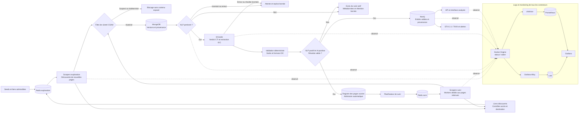

# Documents de conception archi / logicielle — DARKINT

## Vue d'ensemble du pipeline

Ce schéma décrit la cible MVP du 19 octobre 2026, pas l'état déjà implémenté. L'exploration et le suivi utilisent des processus/conteneurs, files Redis et budgets distincts. Le NLP puis l'IA admettent automatiquement les pages au suivi après le filtre de sûreté et la validation des sorties ; aucune validation humaine initiale ou périodique n'est nécessaire. La pertinence d'une page ne donne aucun droit d'accès supplémentaire.

Le planificateur peut utiliser un `time.Ticker` pour alimenter `crawl:refresh` à partir des échéances persistées. `crawl:exploration` reste réservé à la découverte. Les traitements NLP/parser peuvent continuer à lire périodiquement leurs entrées MongoDB. Les deux pools partagent les limites de débit par source et un verrou par page ; les pages suivies conservent un curseur et leurs versions. Le [cadrage MVP](mvp-2027-cadrage.md) définit les états, les règles d'admission et les critères d'acceptation.

## Composants (état actuel vs. cible semestre)

| Service | Rôle | Statut |
|---|---|---|
| `apps/proxy` | 3 instances Tor (`tor1/2/3`), point de sortie réseau pour le crawler | **Existant** |
| `apps/crawler` | Découverte de pages depuis des seeds .onion, écriture dans Redis + Neo4j | **Existant**, à faire évoluer vers collecte continue planifiée |
| `apps/scraper` | Consomme la file Redis, récupère le contenu des pages, persiste dans MongoDB | **Existant**, à séparer en pools exploration/suivi, avec limites de débit et contrôles de sûreté sans contournement |
| Planificateur et registre des pages suivies | Admission automatique NLP/IA, échéances et file `crawl:refresh` ; aucun accord humain requis | **Cible MVP, à implémenter** |
| `apps/classifier` | Triage ML (TF-IDF + régression logistique) pertinent / non pertinent | **Existant**, boucle de ré-entraînement à automatiser |
| `parser` (nouveau service Go) | Extraction d'entités (IOC, TTPs, acteurs) via LLM local (Ollama) + repli cloud (Claude) | **Conçu** (`docs/plans/2026-09-14-entity-parser-*.md`), à implémenter |
| Neo4j | Graphe de corrélation (acteurs, pseudonymes, wallets, fuites) | **Existant** (intégration crawler déjà câblée dans `apps/crawler/internal/db/neo4j.go`), schéma à enrichir |
| `apps/api` | Exposition des données MongoDB vers le front | **Existant** |
| `apps/front` / `apps/target` | Interfaces web (consultation, démonstration) | **Existant**, à étendre pour la visualisation de graphe |
| Connecteur STIX 2.1/TAXII | Export vers MISP/SIEM | **À concevoir et implémenter** |
| Télégram bot | Collecte sur canaux publics | **À concevoir et implémenter** |
| Alerting | Notification sur nouvel acteur/TTP | **À concevoir et implémenter** |
| Grafana Alloy + Loki | Collecte et conservation centralisée des logs Docker du projet | **Implémenté** (`docker-compose.monitoring.yaml`) |
| cAdvisor + Prometheus | Mesures CPU, mémoire, réseau et état des conteneurs | **Implémenté** (`docker-compose.monitoring.yaml`) |
| Grafana | Dashboard commun : état, performances, erreurs et logs | **Implémenté** (`monitoring/grafana/dashboards/bluewhitethreat-overview.json`) |

## Décisions de conception clés

**1. Chaque étape du pipeline reste un binaire Go autonome.** C'est la convention déjà en place (`crawler`, `scraper`, `classifier`, `api`) ; le futur service `parser` et le futur connecteur Telegram la suivent, plutôt que d'être greffés dans un service existant. Avantage : chaque composant peut être redéployé, mis à l'échelle ou remplacé indépendamment (ex. ré-exécuter l'extraction d'entités sur tout l'historique sans re-scraper).

**2. MongoDB comme stockage brut, Neo4j comme stockage relationnel.** Après le filtre de sûreté, MongoDB garde les versions du contenu scrapé avec provenance et rétention bornée (document-oriented, schéma flexible pour des sources hétérogènes : forums, marketplaces, Telegram). Neo4j ne reçoit que les entités extraites et leurs relations — c'est le graphe qui porte la valeur analytique (qui est lié à qui), pas le texte brut.

**3. Extraction en deux temps : LLM local + validation déterministe, et repli cloud conditionnel.** Détaillé dans `docs/theorie-extraction-entites-cti.md`. Résumé : Ollama (modèle local, gratuit, confidentiel) extrait en premier ; une validation regex élimine les hallucinations de format sur les champs vérifiables (IP, hash, domaine, CVE) ; un repli vers un modèle cloud (Claude) n'est déclenché que sur les cas ambigus ou les échecs du modèle local, pour limiter le coût et la fuite de données vers l'extérieur.

**4. Scoring de confiance par entité** (nouveauté MVP élargi) : chaque entité extraite porte un score reflétant la fiabilité de la source et la cohérence inter-mentions (une entité vue dans plusieurs documents indépendants est plus fiable qu'une mention isolée). Ce score est stocké comme propriété du nœud/relation Neo4j, et conditionne l'affichage dans l'interface de visualisation (ex. griser les relations à faible confiance).

**5. Le graphe est alimenté en continu, pas en batch.** Chaque nouvelle extraction d'entités déclenche une écriture incrémentale dans Neo4j (merge sur les nœuds existants plutôt que recréation), ce qui permet à la fois la visualisation temps quasi-réel et la reconstitution d'un historique (qui a été vu lié à qui, et quand).

**6. Export STIX 2.1/TAXII comme traducteur, pas comme stockage.** Le connecteur lit le graphe Neo4j et produit des objets STIX (Indicator, Threat Actor, Relationship) à la demande ou sur abonnement TAXII — il ne duplique pas la donnée, il la projette dans un format interopérable pour MISP/SIEM.

## Flux de données détaillé (entité → graphe → export)

1. Le `parser` lit un document MongoDB classé pertinent par le classifieur.
2. Il appelle `Extractor.Extract(ctx, text)` (interface commune à `OllamaExtractor` et `ClaudeExtractor`), obtient une structure `Entities` (IOCs, CVEs, Malware, ThreatActors, Infrastructure).
3. `ValidateAndClean` filtre les champs à format vérifiable (IP, hash, domaine, CVE) ; les champs en langage libre (noms de malware/acteurs) sont conservés tels quels, la validation sémantique restant hors périmètre (cf. théorie, §4).
4. Un score de confiance est calculé par entité (fiabilité de la source + récurrence inter-documents) et attaché à l'entité avant écriture.
5. Les entités et leurs relations sont fusionnées (`MERGE` Cypher) dans Neo4j : nouveaux nœuds créés, nœuds existants enrichis (nouvelle mention, score mis à jour).
6. L'interface de visualisation interroge Neo4j pour afficher le graphe autour d'un acteur, avec filtre temporel (historique des relations).
7. Le connecteur STIX traduit un sous-graphe en objets STIX 2.1 et les publie via TAXII vers une instance MISP de test.
8. Le module d'alerting surveille les écritures Neo4j et notifie (ex. webhook/email) l'apparition d'un nœud correspondant à un acteur ou TTP déjà surveillé (liste de surveillance configurée par l'équipe).

## Garde-fous de conception (hérités du MoSCoW/SWOT)

- Le périmètre de collecte reste strictement du contenu CTI classique (IOC, acteurs, TTPs) ; aucune fonctionnalité de cartographie de contenus pédopornographiques ou assimilés n'est envisagée, quelle qu'en soit la justification — exclu par principe du périmètre (cf. `docs/sidequest-moscow.md`, section Won't have).
- Le repli cloud (Claude) n'est utilisé qu'en dernier recours, pour limiter l'exposition de contenu sensible scrapé à un tiers.
- Aucun signalement automatisé aux autorités n'est implémenté ; l'alerting de ce projet porte uniquement sur l'apparition d'acteurs/TTPs dans le graphe, à usage interne de l'équipe/SOC utilisatrice.

**7. Exploration et suivi indépendants.** Les scrapers d'exploration découvrent les pages. Les scrapers de suivi actualisent uniquement les pages admises par NLP positif + verdict CTI IA positif + résultat valide, avec leur pagination. Les liens nouveaux retournent en exploration. Une réponse inchangée évite une nouvelle analyse ; chaque version modifiée repasse par sûreté, NLP, IA et validation. Un verdict négatif désactive le suivi, un échec technique le met en attente avec reprise bornée. L'admission d'une page ne qualifie pas automatiquement tout son domaine.
