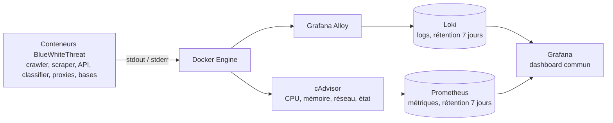

# Monitoring local BlueWhiteThreat

Cette extension Compose ajoute un tableau unique pour les conteneurs, leurs performances et leurs logs :

- Grafana : interface et dashboard ;
- Prometheus : séries temporelles ;
- cAdvisor : CPU, mémoire, réseau et activité des conteneurs ;
- Loki : stockage des logs pendant 7 jours ;
- Grafana Alloy : découverte des conteneurs du projet et envoi de leurs logs à Loki.

Le tableau contient un inventaire permanent des services applicatifs et techniques attendus : `crawler`, `scraper`, `api`, `classifier`, `tor1`, `tor2`, `tor3`, `front`, `target`, `mongodb`, `redis`, `neo4j`, `mongo-express`, ainsi que les cinq composants de monitoring. Un service arrêté reste visible avec l'état **HORS LIGNE** ; son état, ses métriques et ses logs sont alimentés automatiquement dès que son conteneur rejoint le projet Compose `bluewhitethreat`.

## Architecture des logs et des métriques



Alloy et cAdvisor découvrent automatiquement les conteneurs portant le label Compose `com.docker.compose.project=bluewhitethreat`. Les services applicatifs n'ont donc pas besoin d'une configuration Grafana individuelle pour fournir leurs logs Docker et leurs métriques d'infrastructure.

## Démarrer

Depuis la racine du dépôt :

```bash
export GRAFANA_ADMIN_USER=admin
export GRAFANA_ADMIN_PASSWORD='choisir-un-mot-de-passe-local'
docker compose -p bluewhitethreat -f docker-compose.monitoring.yaml up -d
```

Le nom de projet `bluewhitethreat` est important : Alloy filtre les logs sur ce label Compose afin de ne pas collecter les logs des autres projets Docker de la machine.

Pour démarrer simultanément l'application et le monitoring, après préparation des fichiers `.env` applicatifs :

```bash
docker compose -p bluewhitethreat \
  -f docker-compose.yaml \
  -f docker-compose.monitoring.yaml \
  up -d
```

Le monitoring peut fonctionner seul pendant le développement ; les services applicatifs qui rejoignent ensuite le même projet Compose apparaissent automatiquement.

## Accès

| Interface | Adresse | Usage |
|---|---|---|
| Grafana | `http://localhost:3000` | Dashboard principal et exploration |
| Prometheus | `http://localhost:9090` | Requêtes et état des cibles |
| Loki | `http://localhost:3100/ready` | Contrôle de disponibilité |
| Alloy | `http://localhost:12345/graph` | Graphe de collecte et debug |
| cAdvisor | `http://localhost:8084` | Diagnostic brut des conteneurs |

Après connexion à Grafana, ouvrir le dossier **BlueWhiteThreat**, puis le dashboard **BlueWhiteThreat — Docker, performances et logs**.

Le filtre **Service** permet d'isoler, par exemple, le crawler, le scraper, l'API, le classifieur ou les proxies Tor. Le filtre **Conteneur** est recalculé à partir des services sélectionnés.

Les sources Prometheus et Loki ainsi que le dashboard sont provisionnés automatiquement depuis Git ; ils ne doivent pas être modifiés directement dans l'interface.

## Vérifier

```bash
docker compose -p bluewhitethreat -f docker-compose.monitoring.yaml ps
docker compose -p bluewhitethreat -f docker-compose.monitoring.yaml logs --tail=100
curl -fsS http://localhost:9090/-/ready
curl -fsS http://localhost:3100/ready
curl -fsS http://localhost:12345/-/ready
curl -fsS http://localhost:3000/api/health
```

Dans Prometheus, la page `Status > Target health` doit afficher `prometheus`, `cadvisor`, `loki` et `alloy` à l'état `UP`.

Dans Grafana :

1. le panneau **État de tous les services BlueWhiteThreat** doit toujours afficher l'inventaire attendu ;
2. le sélecteur **Service** doit permettre d'isoler un ou plusieurs services ;
3. le sélecteur **Conteneur** doit proposer les conteneurs détectés pour ces services ;
4. les graphes CPU, mémoire et réseau doivent recevoir des données pour les services en ligne ;
5. le panneau de logs doit afficher les logs des services BlueWhiteThreat ;
6. le compteur d'erreurs doit évoluer si une ligne contient `error`, `fatal`, `panic`, `failed`, `erreur` ou `échec`.

Le dashboard n'allume pas les services arrêtés. Le crawler et le scraper doivent être lancés volontairement après les contrôles de sécurité et de configuration décrits dans `docs/runbook-services.md`.

## Exploitation

Suivre les logs du monitoring :

```bash
docker compose -p bluewhitethreat -f docker-compose.monitoring.yaml logs -f alloy loki prometheus grafana cadvisor
```

Redémarrer un composant :

```bash
docker compose -p bluewhitethreat -f docker-compose.monitoring.yaml restart alloy
```

Recharger la configuration Prometheus après modification :

```bash
curl -X POST http://localhost:9090/-/reload
```

Arrêter en conservant l'historique :

```bash
docker compose -p bluewhitethreat -f docker-compose.monitoring.yaml down
```

Les volumes `grafana_data`, `prometheus_data`, `loki_data` et `alloy_data` sont conservés. Ne pas ajouter `-v` sauf remise à zéro explicitement voulue : cette option efface dashboards locaux, métriques et logs conservés.

### Redémarrage et suppression des volumes

- `down` puis `up -d` : les volumes sont conservés ; Grafana, les métriques, les logs et les bases retrouvent leurs données.
- `down -v` : les volumes sont supprimés et recréés vides au prochain démarrage. L'historique Prometheus/Loki, les réglages locaux Grafana et les données MongoDB/Neo4j sont perdus.
- Le dashboard et les sources Grafana sont recréés automatiquement depuis les fichiers du dépôt.
- Les fichiers du projet, `.env` locaux, `model.json` et le dossier lié `db/redis` ne sont pas supprimés par `down -v`.

Après une remise à zéro, définir de nouveau `GRAFANA_ADMIN_USER` et `GRAFANA_ADMIN_PASSWORD`, puis relancer la commande `up -d`. Pour un simple arrêt ou une mise à jour, toujours préférer `down` sans `-v`.

## Données et sécurité

- Le port du Docker Engine est monté en lecture seule dans Alloy.
- cAdvisor nécessite un accès privilégié et des montages hôte en lecture seule pour lire les statistiques des conteneurs.
- Les logs sont limités au projet Compose `bluewhitethreat`.
- Loki et Grafana sont configurés pour un usage local, sans authentification Loki ni TLS ; ne pas exposer leurs ports sur un réseau partagé.
- Les journaux applicatifs ne doivent jamais contenir de secret, token, contenu interdit ou texte source sensible.
- Changer le mot de passe Grafana par défaut avant toute utilisation partagée.

## Limites actuelles

- cAdvisor expose les métriques d'infrastructure, pas encore les métriques métier internes.
- Les services Go n'exposent pas encore d'endpoint Prometheus `/metrics`.
- Les indicateurs tels que taille des files Redis, documents MongoDB classés, score moyen ou dérive du modèle nécessitent des exporteurs ou une instrumentation applicative supplémentaire.
- Sur macOS/OrbStack, l'accès de cAdvisor aux cgroups dépend de la machine virtuelle Docker ; le démarrage réel doit être validé sur le poste.

## Ajouter une métrique applicative

Lorsqu'un service Go exposera `/metrics` :

1. ajouter la bibliothèque cliente Prometheus au service ;
2. exposer uniquement des compteurs, jauges et histogrammes sans contenu source ni identifiant sensible ;
3. ajouter la cible à `monitoring/prometheus/prometheus.yml` ;
4. ajouter ou modifier les panneaux dans `monitoring/grafana/dashboards/bluewhitethreat-overview.json` ;
5. mettre à jour `docs/runbook-services.md` et vérifier que la cible est `UP`.
